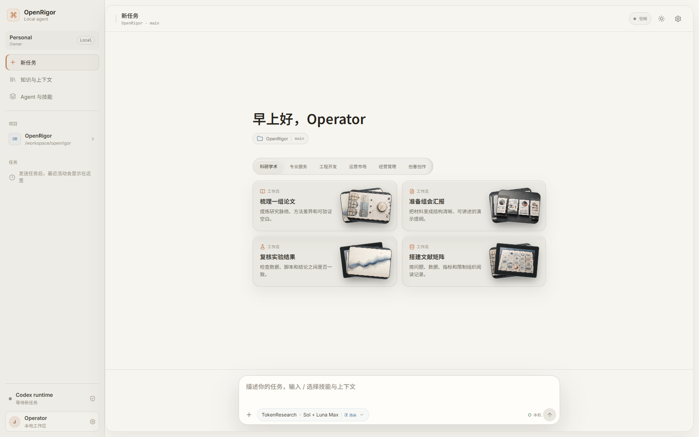
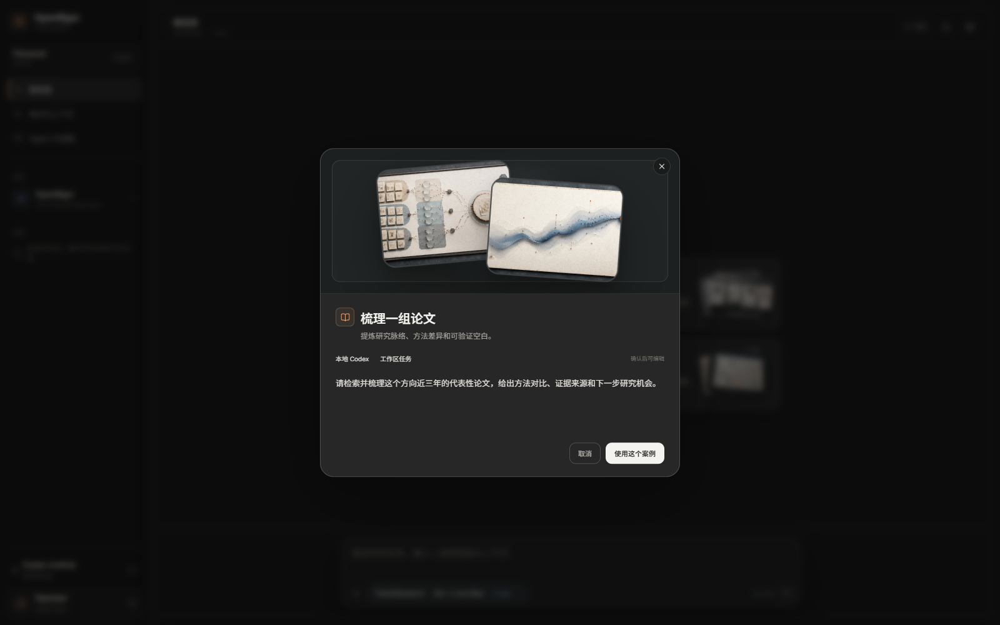
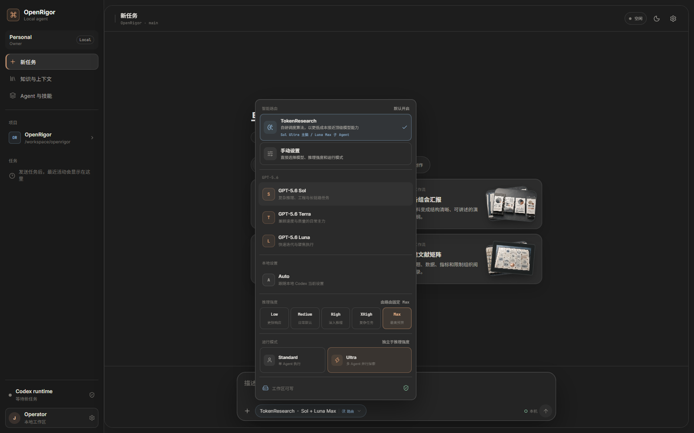
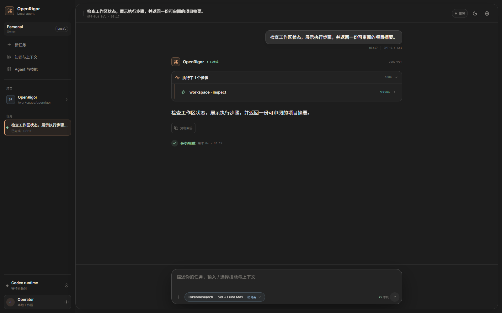

# OpenRigor

OpenRigor is a clean-room, open-source implementation of a persistent AI-agent workspace: a chat-first product that can plan work, run tools in an isolated workspace, stream progress, survive disconnects, and return inspectable files.

[](https://github.com/wangyunjeff/OpenRigor/actions/workflows/ci.yml) [](LICENSE) · [Technical report](docs/TECHNICAL_REPORT.md) · [Roadmap](docs/ROADMAP.md)

This repository is the implementation workspace created from the ClawsGO public-product research snapshot. It does not copy ClawsGO code, branding, screenshots, text, or protected visual assets. The goal is behavioral and architectural equivalence where the behavior is publicly observable.

## Product gallery

<p align="center">
  <picture>
    <source media="(prefers-color-scheme: dark)" srcset="docs/assets/openrigor-home-dark.png">
    <source media="(prefers-color-scheme: light)" srcset="docs/assets/openrigor-home-light.png">
    
  </picture>
</p>

<p align="center"><sub>Desktop-first local agent workspace with task templates, generated previews, and a streaming task composer.</sub></p>

<table>
  <tr>
    <td width="50%" valign="top">
      
      <p><strong>Preview before sending.</strong><br><sub>Open a task template, inspect its generated visual context, and edit the draft before it becomes a run.</sub></p>
    </td>
    <td width="50%" valign="top">
      
      <p><strong>Model and routing controls.</strong><br><sub>Choose Sol, Terra, or Luna, select reasoning depth from Low to Max, and switch between Standard, Ultra, and TokenResearch routing.</sub></p>
    </td>
  </tr>
  <tr>
    <td width="50%" valign="top">
      
      <p><strong>Inspectable execution.</strong><br><sub>Follow the run status, expand individual tool steps, and review the returned answer in the same conversation.</sub></p>
    </td>
    <td width="50%" valign="top">
      
      <p><strong>Light and dark themes.</strong><br><sub>The gallery includes the same workspace in both themes; the first image follows your GitHub color preference when supported.</sub></p>
    </td>
  </tr>
</table>

> The screenshots show the local single-user alpha. Hosted execution, durable history, and sandbox isolation remain on the roadmap.

## Current status

- Research baseline: complete. Read [the full technical report](docs/TECHNICAL_REPORT.md) and the focused [cloud runtime architecture report](docs/CLOUD_RUNTIME_ARCHITECTURE.md).
- Working local alpha: real Codex app-server execution, streamed answers/reasoning/tools/files, SSE replay, stop/interrupt, and same-thread follow-up turns.
- Interface: an original desktop-first operator console with preview-before-send examples, Light/Dark/System themes, Codex-style Sol/Terra/Luna and `low` through `max` controls, a separate Ultra multi-agent mode, knowledge and skill selectors, structured reasoning/tool output, and a browser-side recent-task list.
- Scope: one local user and one configured workspace. Recent conversations can restore their complete in-memory run chain, but runs/events are still process-memory only; attachments, approvals, queued follow-ups, and restart-safe server history are not implemented yet.
- Production execution: intentionally not enabled. A hosted release still needs the durable worker and sandbox boundary described in the architecture docs.

## Start the local Codex alpha

Prerequisites: Node.js 20+, pnpm 9+, a working `codex` CLI, and an existing local Codex login.

```powershell
corepack enable
pnpm install
codex --version
codex login status
pnpm smoke:codex
pnpm dev:codex
```

Open <http://127.0.0.1:5173>. `dev:codex` starts both services, fixes the Codex workspace to this repository, and uses the signed-in local Codex app-server. The browser never receives the Codex auth cache or API key.

The default local sandbox is `workspace-write`, so Codex can work on this repository. For inspection-only use:

```powershell
$env:OPENRIGOR_CODEX_SANDBOX = "read-only"
pnpm dev:codex
```

Interactive approval UI is deferred; unexpected approval and user-input requests are conservatively declined instead of hanging. Stop sends `turn/interrupt` to the active Codex turn.

To run the deterministic UI/API demo without Codex, start `pnpm dev:api` and `pnpm dev:web` in separate terminals.

Useful checks:

```powershell
pnpm typecheck
pnpm test
pnpm build
```

With the API running, the protocol smoke check can be repeated from another terminal:

```powershell
pnpm smoke:api
pnpm smoke:codex
```

## Repository map

```text
apps/web          Vite + React operator console
apps/api          HTTP/SSE transport plus demo and Codex app-server executors
packages/protocol Shared RunRequest/RunEvent contract
infra             Local service dependencies and deployment notes
docs              Research, architecture, protocol, security, roadmap
```

## The first real milestone

Replace the demo executor with a durable queue and a sandbox provider while preserving the public protocol:

1. PostgreSQL for users, workspaces, runs, events, files, and usage ledger.
2. Redis Streams (or NATS JetStream) for dispatch and fan-out.
3. A worker process with idempotent event writes and retry policy.
4. A sandbox provider (gVisor/Kubernetes or Firecracker) with explicit tool capabilities.
5. Object storage for artifacts and signed download URLs.

The implementation order and acceptance criteria are in [docs/ROADMAP.md](docs/ROADMAP.md). The system boundary is documented in [docs/ARCHITECTURE.md](docs/ARCHITECTURE.md), and the wire contract is in [docs/PROTOCOL.md](docs/PROTOCOL.md).

## Clean-room and licensing boundary

OpenRigor is an independent implementation. Use public behavior and public documentation as requirements, write original code and original copy, and obtain separate licenses for model APIs, fonts, icons, media, and any third-party UI source. See [docs/SECURITY.md](docs/SECURITY.md) for the security boundary and [CONTRIBUTING.md](CONTRIBUTING.md) for contribution rules.

## License

MIT. See [LICENSE](LICENSE).
