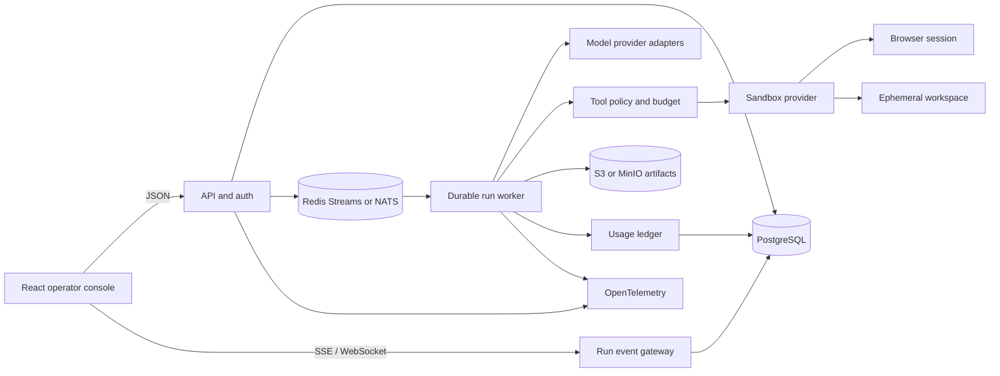
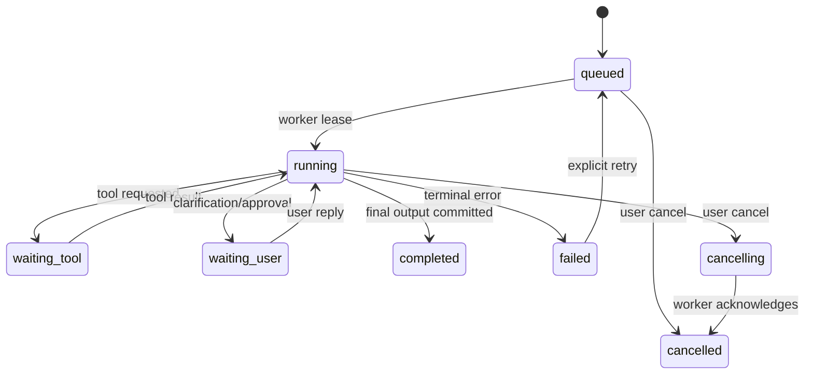

# OpenRigor Architecture

## Design goal

Build a durable, inspectable run system. A user request is a run, not an HTTP request: it can outlive a browser tab, produce many typed events, call tools, create files, and be resumed from a known sequence.

## System shape

## Ownership boundaries

| Component | Owns | Must not own |
|---|---|---|
| API | authentication, request validation, run commands, signed URLs | arbitrary shell execution, provider secrets in client payloads |
| Event gateway | replay, fan-out, backpressure, connection lifecycle | business state transitions without a persisted event |
| Orchestrator | state machine, retries, tool sequencing, model routing | direct public HTTP concerns |
| Sandbox provider | process/filesystem/browser isolation and resource limits | billing or user identity decisions |
| Artifact service | MIME/type validation, virus scan hook, object lifecycle | rendering untrusted HTML in the main origin |
| Metering | provider usage, credits reservation/settlement, idempotency | trusting client-supplied token counts |

## Run lifecycle

Every transition is represented by an append-only event with a monotonic per-run sequence. A projection can be rebuilt from events; the materialized `runs` row is an optimization, not the only source of truth.

## Persistence model (first production cut)

- `users`, `sessions`, `organizations`, `memberships`: identity and tenancy.
- `workspaces`, `workspace_mounts`: logical workspaces and sandbox association.
- `runs`: request, current status, lease, model policy, cancellation version.
- `run_events`: `(run_id, sequence)` unique key, JSON payload, created time.
- `messages`: user-visible messages linked to event ranges.
- `artifacts`: object key, content hash, MIME, size, visibility, scanner result.
- `usage_ledger`: provider request id, input/output units, credit delta, idempotency key.
- `outbox`: transactionally published queue messages.

The first implementation may use the in-memory store in `apps/api`; it is deliberately shaped like the durable model so the transport contract does not need to change during migration.

## Isolation requirements

The worker must receive a short-lived capability token, not the user's provider keys. The sandbox should have:

- a dedicated filesystem and non-root user;
- CPU, memory, process, disk, and wall-clock limits;
- egress policy with an explicit proxy/allow-list;
- no access to the host Docker socket, cloud metadata, or control-plane credentials;
- a separate origin for artifact previews;
- audit records for every tool request and policy decision.

gVisor is a reasonable first provider because it matches the researched product shape; Firecracker is a later option when the threat model and operational maturity justify VM-level isolation.

## Local versus production

| Concern | Local skeleton | Production target |
|---|---|---|
| State | process memory | PostgreSQL + event table |
| Dispatch | demo executor or local `codex app-server` child process | leased queue / durable workflow |
| Stream | in-process listeners | event gateway replaying persisted events |
| Files | fixed local Codex workspace; no artifact service | object store + scan + signed URLs |
| Auth | none | OIDC/OTP, session rotation, RBAC |
| Sandbox | no execution | gVisor/Kubernetes or Firecracker |
| Billing | none | provider usage ledger and Stripe/WeChat adapters |

## Architectural decisions

1. **Protocol first.** The UI and worker communicate through versioned typed events; this allows the executor to change without a frontend rewrite.
2. **At-least-once delivery, idempotent consumers.** Exactly-once delivery is not assumed. Sequence keys and event IDs make replay safe.
3. **Separate control and data planes.** API/auth/billing are control plane; model calls, tools, and files are data plane.
4. **Capability-based tools.** A run receives only the tools and network scope granted by policy.
5. **Artifacts are immutable by default.** Edits create a new revision and preserve the content hash used for audit and replay.
