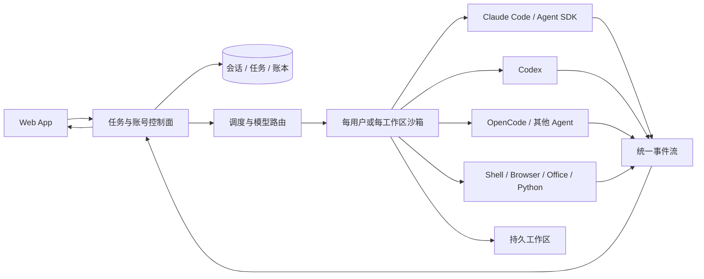
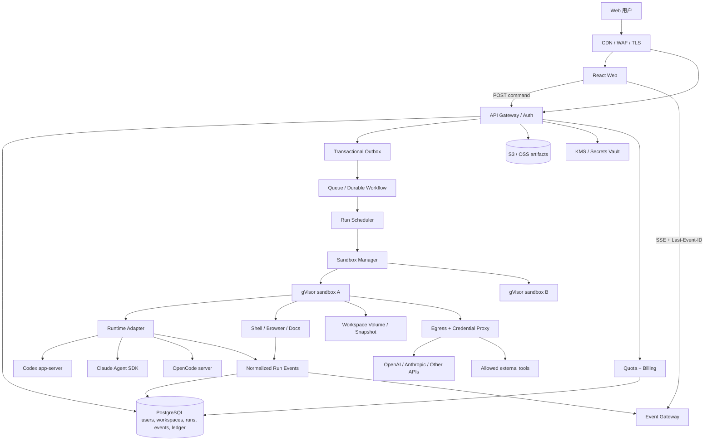

# OpenRigor 云端 Agent 运行架构与 ClawsGo 运行时调研

**调研日期：2026-08-10（Asia/Shanghai）**

**适用对象：产品负责人、技术负责人、云平台与安全团队**

**结论口径：clean-room 功能等价，不复制第三方源码、品牌资产或受保护视觉表达**

> 这是一份“怎么把当前本地单用户版本演进成可商用云服务”的专项报告。完整产品与前端取证见 [TECHNICAL_REPORT.md](TECHNICAL_REPORT.md)，现有事件协议见 [PROTOCOL.md](PROTOCOL.md)，总体边界见 [ARCHITECTURE.md](ARCHITECTURE.md) 与 [SECURITY.md](SECURITY.md)。

## 一、给 jeff 的结论

1. **你的判断大方向是对的。** 2026-08-10 的登录后环境页可直接看到，ClawsGo 的一台云主机中同时安装了 Claude Code、OpenAI Codex、OpenCode、pi-coding-agent、OpenClaw、浏览器和完整文档/数据工具链。它很可能用一个统一控制面按任务或步骤选择 Agent 运行时与模型。
2. **但它不是“前端选一个模型，然后 SSH 上去执行对应 CLI”这么简单。** 真正的产品壁垒是持久任务、沙箱生命周期、事件流、文件交付、会话恢复、模型路由、权限、凭证、用量账本和后台通知。CLI/SDK 只是执行引擎之一。
3. **公开证据不能确认每次任务究竟调用 Claude Agent SDK、Codex app-server、OpenCode，还是自研 Agent loop。** 已安装不等于实际使用。最稳妥的复刻方式是做一个统一 `AgentRuntimeAdapter`，先接 Codex，再按同一协议接 Claude 与 OpenCode。
4. **当前本地版继续走 Codex app-server 是正确路线。** 它适合富客户端所需的线程、turn、reasoning、工具、文件、审批和流式事件。不要把 app-server 的实验性远程 WebSocket 直接暴露给浏览器；生产环境应让它只在沙箱内部通过 stdio/本地 socket 运行。
5. **云端第一版不要真的给每个用户常驻一台完整 VM。** 推荐“逻辑独占工作区 + 可休眠沙箱 + 独立持久卷/对象存储”的混合模式：活跃时唤醒，空闲时释放计算，文件与会话继续存在。用户体验可以是“我的云主机”，底层不必是一人一台永久物理机。
6. **商业版不能转售个人 ChatGPT/Claude 订阅登录态。** Claude 官方明确要求，未经批准第三方不能把 `claude.ai` 登录或额度提供给自己的终端用户；应使用 API Key/企业约定。Codex 的企业级嵌入也应与 OpenAI 确认已知客户端、认证和商业条款。

一句话架构决策：

> **OpenRigor 自己掌握控制面、事件协议、工作区和账本；Codex、Claude、OpenCode 都只是可替换的沙箱内执行适配器。**

## 二、ClawsGo 已确认的公开行为与技术信号

### 2.1 证据等级

- **已确认**：2026-08-10 从官网、隐私政策、响应头、公开静态资源或登录后产品 UI 直接观察到。
- **合理推断**：多个信号一致，但没有服务端源码、云控制台或供应商合同可证明。
- **未知**：仅凭前端无法确认，复刻时应按自己的安全、成本和规模选型。

### 2.2 已确认

| 观察 | 证据 | 对架构的含义 |
|---|---|---|
| 任务在“专属云主机”运行，关闭设备后仍继续 | [ClawsGo 官网](https://clawsgo.ai/) 的 Cloud / Background 小节 | 后端必须有独立于浏览器生命周期的 run、worker 与恢复机制 |
| 可从任意设备续接同一工作区 | 官网 “Every device, one workspace” | 会话与文件不能只保存在浏览器或某个临时进程中 |
| 复杂任务可拆成并行 Agent，并显示每一步所用模型 | 官网 Collective / Research-grade 小节 | 存在模型路由、父子 run、聚合与可观测事件层 |
| 官方展示 Claude Sonnet 5、Claude Opus 5、GPT 5.6 与 Auto | 官网及 App 公开模型 bundle | 至少有多模型产品层；无法仅据此判断底层是 SDK、CLI 还是直接 API |
| 国际站数据存于香港；国际站与中国站账号、数据库独立 | [隐私政策](https://clawsgo.ai/privacy)，最后更新 2026-07-12 | 区域化部署、账号域和数据域是产品级能力，不只是 CDN 分流 |
| 任务内容会发送给 AI 模型与云沙箱供应商；Stripe 处理支付，Google 处理登录 | 隐私政策 | 模型与沙箱供应商都是数据处理者，需要 DPA、区域和留存策略 |
| 登录后有 Agent 指令、技能、记忆、SSH、指标、环境和存储管理 | [ClawsGo App](https://app.clawsgo.ai/) 登录后只读观察 | Agent 配置、外部主机和云工作区属于同一控制面 |
| 指标每 10 秒刷新，当前基础实例显示 2 vCPU、4 GiB RAM、约 9.75 GiB 磁盘 | 登录后“Agent 与云主机 → 指标” | 有实例生命周期与资源计量接口；规格会随套餐或模板变化 |
| 当前环境显示 Ubuntu 24.04.4、`4.19.0-gvisor`、安全内核 gVisor | 登录后“环境”实时探测 | 当前账户的执行环境确实使用 gVisor 边界；不能外推所有区域与所有套餐都完全相同 |
| 重建环境时，文件、任务记录和记忆保存在持久盘 | 登录后“指标 → 重建云主机”说明 | 计算根文件系统与持久状态至少在产品语义上分离 |
| 云主机安装 Claude Code 2.1.200、Codex 0.145.0、OpenCode 1.18.5 | 登录后“环境 → npm 全局包” | 你的“把多个 Agent 装进云主机”判断得到直接支持；但仍不能证明每个模型的实际执行映射 |
| 技能来自云主机实际安装，可由 Agent 在任务中自装 | 登录后“技能”说明 | Skill 是运行时文件/包，不只是前端标签；生产版必须加供应链治理 |
| 计费 UI 区分周期性算力与永不过期算力包，并有流水 | 登录后“团队与订阅” | 必须有服务端 usage ledger，而不能只从前端余额扣数 |

### 2.3 可观察的前端与交付栈

2026-08-10 的响应头与公开资源显示：

- 营销站 `clawsgo.ai` 是 Next.js，响应头包含 `X-Powered-By: Next.js`、RSC 与 prerender 缓存信号。
- `app.clawsgo.ai` 是由 nginx 提供的 Vite/React SPA；入口 bundle 可观察到 React 与 Vite 特征。
- App 使用独立 API 基址 `https://api.clawsgo.ai`。
- 公开资源名包含 `streamStore`、`finishedTasksStore`、`sandbox`、`xterm`、`models`、`AgentBlock`、`FilePreview` 和 `aliyun-sandbox` 等模块。
- `aliyun-sandbox` 这个公开 bundle 名最多说明它曾实现或评估阿里云沙箱相关界面，**不能据此声称生产环境一定由阿里云承载**。

这些信号足以判断“前端 SPA + 独立 API + 独立运行面”，但无法确认 API 服务端语言、数据库、队列或工作流产品。

### 2.4 高概率运行形态

综合官网、环境页与任务轨迹，ClawsGo 很可能接近下面的结构：



更准确的表述是：**它很可能把多套成熟 Agent runtime 当作沙箱内能力，再用自己的控制面统一任务、模型、事件、文件、额度和 UI。**

### 2.5 仍然未知

- 一个账户是否始终绑定一个固定 sandbox/VM，还是按需恢复同一个逻辑工作区。
- Claude、GPT 与 Auto 模型分别由哪一个 Agent runtime 执行。
- 多 Agent 是 Claude/Codex 自带能力，还是 ClawsGo 自己的父子任务编排。
- 生产沙箱是否为自建 Kubernetes + gVisor、第三方 sandbox-as-a-service，或混合形态。
- API 服务端、数据库、队列、对象存储和 workflow engine 的具体产品。
- 模型供应商是直接签约、BYOK，还是经过聚合网关。
- SSH 私钥、浏览器会话和第三方凭证如何加密与注入。

这些未知项不影响复刻；OpenRigor 应选更易审计、更能控制毛利的实现。

## 三、Codex、Claude Code 与 OpenCode：怎么托管

### 3.1 对比结论

| 运行时 | 官方嵌入方式 | 会话与流式过程 | 托管形态 | OpenRigor 推荐用途 |
|---|---|---|---|---|
| Codex | `codex app-server`；自动化可用 Codex SDK | thread/turn、resume/fork、reasoning、工具、文件、审批、usage、增量通知 | app-server 内部 stdio/本地 socket；远程 WebSocket 仍标为实验性、不支持生产 | 当前本地版和第一款云端工程 Agent 的首选 |
| Claude | Claude Agent SDK（TypeScript/Python） | session resume/fork、流式输出、内置工具、subagent、MCP、权限、hooks、skills/memory | SDK 每个会话启动/管理 `claude` 子进程；容器与本地 session state 需自行托管，或改用 Anthropic Managed Agents | 第二个 adapter，适合研究、文档和长任务；必须用合规 API 认证 |
| OpenCode | `opencode serve` + `@opencode-ai/sdk` | session、provider、模型、SSE 全局事件、OpenAPI 3.1 | 沙箱内本地 HTTP server；可由 SDK 同时拉起 server/client | 多供应商与开源兼容层；不要直接作为公网多租户控制面 |

### 3.2 Codex：富交互用 app-server，批处理用 SDK

[官方 Codex app-server 文档](https://learn.chatgpt.com/docs/app-server) 明确把它定位为富客户端嵌入接口，覆盖认证、会话历史、审批和流式 Agent 事件；实现本身在 `openai/codex` 仓库公开。它提供：

- `thread/start`、`thread/resume`、`thread/fork`、`thread/read/list`；
- `turn/start`、`turn/steer`、`turn/interrupt`；
- 文本、reasoning、命令、文件、MCP、审批和 token usage 通知；
- `model/list` 返回模型及 reasoning effort 能力；
- Skills、插件、后台终端和工作区相关接口。

生产建议：

- 浏览器只连接 OpenRigor API/SSE，不连接 app-server。
- 每个活跃 sandbox 内启动一个 app-server supervisor，以 stdio 或本地 Unix socket 通信。
- OpenRigor adapter 只转发白名单字段，把 provider 事件翻译成自己的 `RunEvent`。
- 持久化 Codex `threadId`、runtime 版本、workspace revision 与最后确认的事件序号；重启后使用 `thread/resume`，而不是依赖同一进程永远存活。
- app-server 的远程 WebSocket文档仍标注 experimental/unsupported；即使它提供鉴权，也不应直接承担公网生产网关。

[Codex SDK 文档](https://learn.chatgpt.com/docs/codex-sdk) 更适合 CI、内部工作流或一次性自动化。TypeScript SDK 要求 Node.js 18+，Python SDK 要求 Python 3.10+，并支持 read-only、workspace-write、full-access sandbox preset。对 OpenRigor 来说，**交互式产品优先 app-server，离线 activity/批处理可用 SDK**。

### 3.3 Claude：Agent SDK 本质上是被 SDK 管理的长生命周期子进程

[Claude Agent SDK 概览](https://code.claude.com/docs/en/agent-sdk/overview) 表明，它把 Claude Code 的 agent loop、工具、上下文、session、subagent、MCP、权限、skills、memory 和 plugins 暴露给 TypeScript/Python 应用。

[官方托管文档](https://code.claude.com/docs/en/agent-sdk/hosting) 对生产形态说明得很直接：

- SDK 调用会启动独立 `claude` CLI 子进程，通过 stdio 通信；
- 一个 Agent session 对应一个子进程及其进程树；
- transcript、memory 和工作目录默认在本地磁盘，容器重启后不会自动存在；
- 可采用 ephemeral、long-running、hybrid 或 multi-agent container 模式；
- hybrid 模式需要 `SessionStore`，可对接 S3、Redis、Postgres 或自定义后端；
- 官方给出的新实例起始估算是每 Agent 1 CPU、1 GiB RAM、5 GiB disk，真实资源会随 session 和工具活动增长。

对 OpenRigor 的建议：

- 第一版采用 hybrid session：会话空闲时停进程，恢复时从 SessionStore 和 workspace revision 水合。
- 同一个容器可跑多个子进程只适合受控单租户；跨租户应至少一租户/工作区一 sandbox 边界。
- 给每个 Agent 独立 `cwd` 与配置根，防止 `CLAUDE.md`、skills 和产物互相污染。
- 不把 Claude API key 写入工作区；通过沙箱外代理注入。
- 官方明确说明，未经批准第三方不能向自己的用户提供 `claude.ai` 登录或额度；商业版使用 Anthropic API key、Bedrock/Vertex 或正式企业协议。

### 3.4 OpenCode：最容易做多供应商兼容，但仍需外层控制面

[OpenCode Server 文档](https://opencode.ai/docs/server/) 显示，`opencode serve` 可启动无界面的 HTTP server，暴露 OpenAPI 3.1、会话与 provider API，并通过 `/global/event` 提供 SSE。它可用 Basic Auth 保护，默认绑定 `127.0.0.1:4096`。

[OpenCode SDK 文档](https://opencode.ai/docs/sdk/) 提供类型安全 JS/TS client，可以同时启动 server/client，也可连接已有 server；公开 npm 包当前标注 MIT。

生产建议：

- 只在 sandbox 内绑定 localhost，不把它直接放到公网。
- OpenRigor worker 持有内部 client，并把 session/provider/event 翻译为统一协议。
- Basic Auth 只是一层传输认证，不代表租户隔离、账本、审计和 sandbox 安全已经完成。
- OpenCode 适合作为多供应商兼容执行器或回退引擎，但产品控制面不能依赖其本地状态作为唯一事实源。

### 3.5 许可证与服务条款

| 组件 | 公开包/仓库许可信号 | 需要额外注意 |
|---|---|---|
| OpenRigor | MIT | 保持自己的代码、品牌和素材独立 |
| OpenAI Codex CLI/app-server | Apache-2.0 | 保留 notices；模型服务、ChatGPT 认证和企业嵌入仍受 OpenAI 服务条款约束 |
| OpenCode CLI/SDK | MIT | 逐项核对其依赖与接入的模型供应商条款 |
| Claude Agent SDK | 官方页面指向 Anthropic Commercial Terms；npm 包不是简单 MIT 声明 | 上线前由法务核查分发、品牌、登录与面向终端用户提供服务的边界 |

项目根许可证可以继续是 MIT，但这不自动把外部模型服务、SDK 或品牌使用权变成 MIT。

## 四、OpenRigor 推荐云端架构

### 4.1 总体拓扑



### 4.2 控制面与数据面必须分开

**控制面**负责：

- 登录、组织、项目、角色和授权；
- run、conversation、审批、取消与重试命令；
- 模型策略、预算、配额和账本；
- sandbox 分配、休眠、唤醒和销毁；
- 文件元数据、签名下载和审计。

**数据面**负责：

- 在 sandbox 中运行 Agent runtime、Shell、浏览器和文档工具；
- 读取被授权的 workspace revision；
- 通过受控代理访问模型和外部服务；
- 产生事件、文件和 usage，但不能自行修改账户余额或租户权限。

API 进程绝不能执行用户命令。即便早期用 Docker，Docker 也不能被视为完整多租户安全边界。

### 4.3 统一 Runtime Adapter

建议把不同 Agent 的差异封装在服务端接口内：

```ts
interface AgentRuntimeAdapter {
  capabilities(): Promise<RuntimeCapabilities>;
  start(input: StartRunInput): AsyncIterable<RuntimeEvent>;
  resume(input: ResumeRunInput): AsyncIterable<RuntimeEvent>;
  steer(input: SteerRunInput): Promise<void>;
  cancel(input: CancelRunInput): Promise<void>;
  snapshot(input: RuntimeSnapshotInput): Promise<RuntimeSnapshot>;
}
```

映射建议：

| OpenRigor 动作 | Codex | Claude | OpenCode |
|---|---|---|---|
| 新会话 | `thread/start` | 新 session/query | `POST /session` |
| 继续会话 | `thread/resume` + `turn/start` | resume session + SessionStore | session prompt |
| 运行中追加 | `turn/steer` | streaming input/client | session prompt/command |
| 取消 | `turn/interrupt` | AbortSignal/结束 client | abort session |
| 增量事件 | app-server notifications | SDK async stream | SSE event |
| 模型能力 | `model/list` | 服务端配置与 Anthropic catalog | provider/config API |

Adapter 输出只允许版本化的 OpenRigor 事件：`status`、`part`、`part-delta`、`tool`、`file`、`subagent`、`usage`、`error`、`run-finished`。未知 provider 字段不应原样送到浏览器。

### 4.4 模型、推理强度与 Ultra 应分层

- **模型**：Luna、Terra、Sol、Claude 等实际模型/路由目标。
- **推理强度**：low、medium、high、xhigh、max 等单 Agent 运行参数；只展示当前模型真实支持的档位。
- **Ultra / Cluster**：产品级多 Agent 编排模式，不等于某个模型的 reasoning effort。

Ultra 建议实现为父 run 创建多个 child run，每个 child 有独立模型、预算、sandbox/工作目录与 trace。并行 Agent 不应同时写同一目录；采用独立分支/子目录，最后由 synthesis run 合并。

## 五、会话、工作区与“云主机”生命周期

### 5.1 不把进程、会话和工作区混为一谈

| 概念 | 生命周期 | 主事实源 |
|---|---|---|
| Conversation | 用户多轮对话，可长期保存 | PostgreSQL |
| Run | 一次用户指令及执行状态 | PostgreSQL + append-only events |
| Runtime session | Codex thread / Claude session / OpenCode session | provider metadata + 持久映射 |
| Workspace | 项目文件、技能、记忆与产物 | 持久卷 + 对象存储快照 |
| Sandbox | 某段时间内的计算与隔离实例 | Sandbox manager；可销毁并重建 |

当 sandbox 被销毁时，conversation、run、usage、artifact metadata 仍然存在；需要继续时，以 runtime session id、workspace snapshot 和配置 manifest 恢复。

### 5.2 推荐 hybrid workspace

第一版云端采用：

1. 创建 workspace 时生成独立 ID、初始 volume/snapshot 和策略。
2. run 到来后分配或唤醒一个 sandbox，挂载 workspace。
3. sandbox root filesystem 临时、只读优先；`/workspace` 单独可写。
4. run 期间增量记录文件 hash、事件和 usage。
5. run 完成或空闲超时后，提交 workspace snapshot，释放计算。
6. 下次访问恢复同一逻辑工作区；无需保证落到同一台宿主机。

用户看到的是“我的云主机”，后台实现的是“我的持久工作区 + 可恢复执行环境”。这比永久 VM 成本低，也更容易滚动升级模板。对外文案必须准确：共享宿主上的逻辑隔离实例不能宣称为用户独占的物理服务器。

### 5.3 持久化边界

建议持久化：

- 用户文件、Git 工作树、产物与可复现脚本；
- Agent runtime session 映射与必要 transcript；
- skills manifest、版本、来源 hash、权限声明；
- memory 的来源、创建者、置信度、作用域和修订历史；
- 环境模板版本、依赖锁文件和 workspace snapshot hash。

不要持久化到 workspace：

- 模型 API key、OAuth refresh token、SSH 私钥明文；
- 控制面数据库凭证、云 IAM 凭证；
- 可跨租户复用的浏览器 cookie；
- 原始内部 capability token。

## 六、长任务、队列与流式事件

### 6.1 正确的启动链路

```text
POST /runs
  -> PostgreSQL 事务写 run + outbox
  -> dispatcher 发布 queue message
  -> worker 领取 lease
  -> sandbox waking / provisioning
  -> runtime adapter start/resume
  -> 事件先持久化，再向 SSE fan-out
  -> 文件写 object store，数据库写 revision
  -> usage settlement
  -> terminal event
```

浏览器断开、API 重启或 event gateway 扩容都不应终止 run。SSE 重连时使用 `Last-Event-ID`，先发 snapshot，再补发缺失 sequence。

### 6.2 状态与“看起来卡住”

除了模型 token，持续输出下面的状态事件：

- `queued`：等待 worker；
- `leasing_worker`：分配执行器；
- `waking_sandbox`：唤醒云工作区；
- `hydrating_workspace`：恢复文件与 session；
- `starting_runtime`：启动 Codex/Claude/OpenCode；
- `running_tool`：工具名、开始时间、已耗时；
- `waiting_provider`：等待模型首 token；
- `checkpointing`：保存 workspace；
- `settling_usage`：结算；
- `completed / failed / cancelled`。

运行中每 5-10 秒发送轻量 heartbeat，但不伪造进度百分比。UI 可显示当前阶段、已耗时、最近一次事件时间和取消状态。

### 6.3 可靠性规则

- 队列与事件均按 **at least once** 设计。
- `(run_id, sequence)`、`client_request_id`、provider request id 与 ledger idempotency key 必须唯一。
- worker 使用 lease + heartbeat，过期后可重领；重试前检查 provider/run 当前状态。
- 工具写操作需要 operation id，避免重放时重复提交、重复发邮件或重复付款。
- terminal event 只有一个；usage 可增量结算，最终做 reconciliation。
- 继续对话创建新 run 并引用上一终态 run，不能覆盖旧 run。

## 七、安全隔离与凭证

### 7.1 最低生产边界

每个不受信任的 workspace 至少应具备：

- 非 root 用户、只读 rootfs、独立 PID/network/mount namespace；
- CPU、内存、进程数、磁盘、文件数、输出大小与 wall-clock 限制；
- gVisor `runsc` 作为第一阶段运行时；高风险/企业租户可升级 Firecracker/Kata；
- 禁止挂载 Docker socket、Kubernetes service-account token 和控制面目录；
- 阻断云 metadata 地址与控制面内网；
- 默认拒绝出网，只能经过 egress proxy/allowlist；
- 独立 artifact preview origin，禁在主站 origin 直接执行用户 HTML/JS；
- 上传文件 MIME sniff、大小限制、恶意文件扫描与解压炸弹防护；
- tool、网络、审批与策略决策均有审计记录。

[Claude Secure Deployment](https://code.claude.com/docs/en/agent-sdk/secure-deployment) 同样推荐把凭证放在 Agent 边界之外，通过代理注入；该思路也适用于 Codex 与 OpenCode。

### 7.2 凭证代理模式

```text
Agent sandbox -> 无真实凭证的请求 -> Egress/Tool Proxy
              -> 校验 run capability / 域名 / 方法 / 预算
              -> 注入真实 provider credential
              -> 外部 API
```

建议：

- 长期密钥只存 KMS/Vault/云 Secret Manager。
- sandbox 获得的是短期、单 run、单服务 capability，而不是平台 master key。
- GitHub、数据库、SSH 等敏感能力优先做成沙箱外 MCP/tool service；Agent只看到受限接口。
- SSH 使用加密 secret、host fingerprint、命令审计与一次性连接授权；不要把私钥写入 prompt 或事件。
- 浏览器事件、SSE、日志和报错统一做 secret redaction。
- Terminal WebSocket 使用短时一次性 ticket，绑定 user、workspace、sandbox、origin、expiry；禁止把长期 bearer token 放在 URL。

### 7.3 认证边界

- OpenRigor 用户登录使用 OIDC/OTP，Web 端用 HttpOnly + Secure + SameSite Cookie。
- 本地单用户版可以复用本机 Codex 登录态，但绝不能直接升级为公网多用户方案。
- OpenAI 商业接入优先 API project/service account 或正式企业约定；如使用 Codex app-server 的 ChatGPT managed auth，需先确认面向终端用户的授权与已知客户端要求。
- Claude 商业接入使用 Anthropic API、Bedrock 或 Vertex 的正式凭证；不要转售个人 `claude.ai` 登录态。
- OpenCode 可管理多 provider，但每个 provider 的 OAuth/转售条款仍需单独确认。

## 八、用量、额度与计费

前端的“算力”只是零售单位，真实账本至少记录：

```text
provider_request_id (unique)
run_id / child_run_id / tenant_id
provider / model / effort / mode
input_tokens / output_tokens / cached_tokens
tool units: search, browser, image, OCR
sandbox_cpu_ms / memory_gb_s / active_seconds
storage_byte_days / egress_bytes
provider_cost / internal_cost / retail_charge / currency
reservation / settled / refunded status
idempotency_key
```

结算流程：

1. run 开始前按 hard budget 预留额度。
2. 每次模型与付费工具调用增量写 usage ledger。
3. 完成后按真实 usage settlement，多退少补。
4. provider timeout、重试和重复事件通过 request id 去重。
5. 每日把内部账本与供应商账单对账。

套餐还要限制并发 run、活跃 sandbox、最大磁盘、文件大小、子 Agent 数、单 run wall time 和高价模型可用性。Ultra 多 Agent 必须有单独预算，不能无限递归。

## 九、从现在到商用的分阶段路线

### 阶段 L0：本地单用户（现在）

目标：jeff 自己能用，交互与执行过程完整。

- Web + API + 本机 `codex app-server`。
- 使用现有 Codex 登录态和固定工作目录。
- 模型/effort、继续会话、停止、reasoning、工具与文件事件可视化。
- 明确标注：进程内状态、无多租户隔离、不能公网开放。

验收：连续多轮能在同一 Codex thread 上继续；执行中有心跳/状态；服务重启边界清楚。

### 阶段 L1：持久单租户 alpha

目标：浏览器、API、worker 任一重启不丢 run。

- PostgreSQL `runs/run_events/conversations/artifacts/usage_ledger/outbox`。
- Redis Streams、NATS JetStream 或 Temporal 三选一；早期可先 outbox + Redis Streams。
- 独立 worker 与 Codex adapter。
- workspace snapshot、对象存储、事件 replay 与取消幂等。

验收：运行中重启 API，任务继续；重连得到相同事件序列；账本可从 provider request id 重建。

### 阶段 L2：私有云 beta

目标：少量受邀用户在远端真正使用。

- 控制面与执行节点分离。
- gVisor sandbox、限额、egress proxy、KMS、对象存储和 artifact 隔离域。
- OIDC、workspace ownership、审计、配额。
- 第一阶段只开放 Codex adapter；Claude/OpenCode先做内部 feature flag。

验收：恶意 prompt/文件无法读取控制面 secret、其他 workspace 或宿主机；30 分钟任务可休眠/恢复。

### 阶段 L3：多运行时与团队

目标：实现 ClawsGo 类多模型、技能、记忆、项目与团队体验。

- Claude Agent SDK 和 OpenCode adapter。
- Auto router 与显式模型选择；Ultra 父子 run。
- Skills registry、签名/扫描/权限 manifest。
- 团队 RBAC、共享 workspace、只读分享、通知。
- 正式 usage ledger、套餐与支付。

验收：不同 runtime 的事件在同一 UI 行为一致；跨租户安全测试和账本对账通过。

### 阶段 L4：商用与区域化

- 托管 PostgreSQL、对象存储、多 AZ、备份恢复演练。
- 多 sandbox node pool、热池、容量预测和成本告警。
- 中国区与国际区独立账号、数据库、密钥与供应商策略。
- 企业 SSO、DPA、数据删除/导出、审计导出、SLO 与事故响应。
- 高安全租户可用 Firecracker/Kata 或独立 cell/集群。

## 十、推荐部署拓扑与起步容量

### 10.1 单用户远端 POC

不要把 arbitrary code execution 与数据库/API 放在同一信任边界。最小也建议：

- 控制面：2-4 vCPU、4-8 GiB RAM；运行 API、event gateway 和 dispatcher。
- 执行节点：4-8 vCPU、16 GiB RAM、NVMe，支持 gVisor；只运行 sandbox/worker。
- PostgreSQL：托管或独立实例，启用 PITR。
- Redis/NATS：小规格即可，run event 真相仍在 PostgreSQL。
- S3/OSS：artifact、workspace snapshot、备份。

这是 POC 起点，不是正式容量承诺。含浏览器、LibreOffice、LaTeX 的重任务通常需要比纯 CLI 更多内存。

### 10.2 容量估算

按并发活跃 Agent 而不是注册用户估算：

```text
所需 CPU 约等于：并发活跃 Agent × 每 Agent CPU 配额 × 峰值系数
所需内存约等于：并发活跃 Agent × 每 Agent 内存配额 + warm pool + 节点开销
存储约等于：活跃 workspace 容量 + snapshot/versioning + artifact retention
```

试运行先以每 Agent 1-2 vCPU、2-4 GiB RAM、5-10 GiB workspace 配额压测；文档渲染、浏览器和多 Agent 再提高。最终以 TTFT、任务时长、OOM、磁盘 IOPS 和毛利数据决定。

### 10.3 Kubernetes 产品形态

- Control-plane namespace：API、event gateway、scheduler，无运行用户命令权限。
- Data-plane node pool：gVisor RuntimeClass，禁止访问控制面网段和 metadata。
- Egress proxy namespace：集中 allowlist、凭证注入与审计。
- Artifact preview 使用独立域名与严格 CSP。
- 每个 sandbox 有 owner/workspace/run labels、resource quota、TTL 与网络策略。
- 不允许 sandbox 使用宿主 Docker socket，也不使用 Docker-in-Docker 作为常规方案。

## 十一、需要 jeff 提供或决定的资源

### 11.1 现在本地版

当前无需新增云资源。需要确认：

- 继续使用本机 Codex 登录态，还是改为 OpenAI API project key。
- OpenRigor 允许操作的工作目录范围。
- 默认 sandbox policy：`workspace-write` 还是 `read-only`。
- 单次任务允许的最长时长与是否默认允许联网。

### 11.2 私有云 POC 前必须准备

- [ ] 云账号与主区域：香港或新加坡优先；若面向中国大陆，另做独立部署决策。
- [ ] 一个控制面主机和一个支持 gVisor 的执行节点，或选定 E2B/Daytona/Modal 等 sandbox 服务做 POC。
- [ ] 域名与 DNS：建议 `app`、`api`、`events`、`files` 分域。
- [ ] 托管 PostgreSQL、Redis/NATS 与 S3/OSS bucket。
- [ ] KMS/Secret Manager。
- [ ] OpenAI API project/服务凭证与预算上限。
- [ ] GitHub Organization、container registry 与 CI deploy identity。
- [ ] 错误与可观测性：Sentry 或 OTel collector + 日志/指标后端。
- [ ] 邮件通知服务；短信暂可后置。

### 11.3 接 Claude 与 OpenCode 前

- [ ] Anthropic API、Amazon Bedrock 或 Vertex AI 的正式账号与商业用途确认。
- [ ] 是否允许 BYOK；若允许，定义密钥加密、删除与轮换流程。
- [ ] OpenCode 要支持的 provider 清单和各自条款。
- [ ] Runtime/模型显示名称与品牌使用审查。
- [ ] Claude Agent SDK 分发与终端用户服务条款的法务结论。

### 11.4 商用前

- [ ] 目标市场、数据驻留、留存期、删除 SLA 与备份保留期。
- [ ] Google/GitHub OIDC；中国区手机 OTP 与实名/备案策略另行评估。
- [ ] Stripe 账号；中国区支付必须走独立合规方案。
- [ ] 隐私政策、服务条款、DPA、子处理者清单、退款与滥用政策。
- [ ] 套餐、零售 credits 定义、并发/磁盘/模型/Ultra 上限。
- [ ] 安全测试预算：sandbox escape、SSRF、prompt injection、secret exfiltration、租户越权。
- [ ] 值班、告警、备份恢复与事故响应负责人。

## 十二、建议现在就做与暂时不要做

### 现在就做

1. 保持 `RunEvent` 协议与 UI 解耦，Codex 只是第一个 adapter。
2. 先补 PostgreSQL events、outbox、worker lease 与 replay，这是云化前置条件。
3. 把 `Ultra` 定义为多 Agent orchestration mode，而不是 Luna 的推理档位。
4. 设计 workspace snapshot 与 runtime session mapping，避免未来被单一 CLI 的本地文件绑死。
5. 先做 egress proxy 和 secret boundary，再增加可联网工具。
6. 从第一天记录 provider usage、sandbox 时间、存储与工具费用。

### 暂时不要做

1. 不要让浏览器直接连 Codex app-server、Claude 子进程或 OpenCode server。
2. 不要把个人 ChatGPT/Claude cookie 或 OAuth token 存进云主机给终端用户共享。
3. 不要让 API 服务运行用户 Shell。
4. 不要一开始永久分配一人一台 VM；先证明 hybrid suspend/resume。
5. 不要同时开发三套 runtime；Codex 跑稳、协议持久化后再加 Claude。
6. 不要复制 ClawsGo 的 bundle、商标、文案、截图和内部命名；公开行为仅作为需求与验收依据。

## 十三、建议的验证实验

在投入完整云平台前，用 2-3 周完成下面实验：

1. **Codex 恢复实验**：中途杀掉 API 与 app-server，使用持久映射恢复同一 thread，验证事件无重复/缺失。
2. **沙箱恢复实验**：销毁 gVisor sandbox，从 workspace snapshot 恢复后继续同一 run。
3. **凭证外置实验**：sandbox 内不存在真实 provider key，仍能通过 egress proxy调用模型与 GitHub 受限工具。
4. **跨 runtime 事件实验**：Codex 与 Claude 对同一测试任务输出相同 OpenRigor event contract。
5. **多 Agent 文件冲突实验**：三个 child run 独立工作目录，最终合并，确认没有并发覆盖。
6. **毛利实验**：记录模型 token、browser、sandbox CPU/内存、存储和文件渲染成本，建立真实 credits 换算。
7. **攻击实验**：恶意网页/附件尝试读取 metadata、宿主文件、其他 workspace 与环境变量，必须失败且留审计。

完成这七项后，才适合决定是自建 Kubernetes + gVisor，还是采购 sandbox-as-a-service。

## 十四、证据与官方资料

以下页面均于 **2026-08-10** 访问或复核：

### ClawsGo

- [ClawsGo 官网：云主机、模型路由、后台运行、多 Agent 与研究交付](https://clawsgo.ai/)
- [ClawsGo App：登录后 Agent、云主机、环境、指标、存储、团队与计费界面](https://app.clawsgo.ai/)
- [ClawsGo 隐私政策：香港存储、区域隔离、模型/沙箱/Stripe/Google 子处理者](https://clawsgo.ai/privacy)
- [ClawsGo 服务条款](https://clawsgo.ai/terms)

### OpenAI Codex

- [OpenAI Docs：Codex 模型选择、Max 与 Ultra](https://learn.chatgpt.com/docs/models)
- [OpenAI API：GPT-5.6、Max、Pro 与 Multi-agent](https://developers.openai.com/api/docs/guides/latest-model)
- [OpenAI Docs：Codex app-server](https://learn.chatgpt.com/docs/app-server)
- [OpenAI Docs：Codex SDK](https://learn.chatgpt.com/docs/codex-sdk)
- [OpenAI Codex 开源仓库](https://github.com/openai/codex)

### Claude

- [Claude Agent SDK 概览](https://code.claude.com/docs/en/agent-sdk/overview)
- [Hosting the Agent SDK](https://code.claude.com/docs/en/agent-sdk/hosting)
- [Securely deploying AI agents](https://code.claude.com/docs/en/agent-sdk/secure-deployment)
- [Anthropic Managed Agents 概览](https://platform.claude.com/docs/en/managed-agents/overview)

### OpenCode 与沙箱

- [OpenCode Server](https://opencode.ai/docs/server/)
- [OpenCode SDK](https://opencode.ai/docs/sdk/)
- [OpenCode 源码](https://github.com/anomalyco/opencode)
- [gVisor 文档](https://gvisor.dev/docs/)
- [Firecracker 文档](https://firecracker-microvm.github.io/)

## 最终建议

ClawsGo 当前可观察到的形态，基本印证了“云 Linux 工作区预装 Claude Code、Codex、OpenCode 等能力，再由统一产品层编排”的路线；但它的核心并不是这些 CLI 本身，而是它们上面的持久控制面。

OpenRigor 应按下面顺序建设：

> **Codex 本地体验跑顺 → run/event 持久化 → 独立 worker → gVisor 云沙箱 → workspace 恢复与对象存储 → 凭证代理和账本 → Claude/OpenCode adapter → Auto/Ultra 多 Agent → 团队与商业化。**

这样既能尽快让 jeff 自己用上，也不会在后续云化时推翻第一版。
