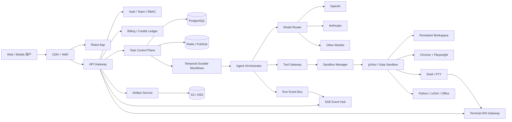

# ClawsGO 功能等价复刻与 OpenRigor 技术尽调报告

**外部调研快照：2026-08-09（Asia/Shanghai）**

**OpenRigor 实施状态：2026-08-10（桌面端优先的单用户本地 alpha）**

**目标：从公司立项视角，判断 ClawsGO 的真实技术构成、AIcss 的关系，并记录功能等价产品所需的技术、当前实现和演进路线。**

> 本报告所说的“1:1 复刻”是功能、工作流和交付能力等价，不建议复制 ClawsGO 的商标、文案、视觉资产、客户端源码或受保护的界面表达。ClawsGO 的公开条款明确保留软件、界面和品牌权利，并限制逆向工程。推荐采用 clean-room（洁净室）方式：一组人只编写公开行为规格，另一组人基于规格独立实现。

## 一、给管理层的结论

### 当前执行口径

OpenRigor 已经不是静态界面稿。当前版本先把老板本人可用的最小闭环做实，再向云端多租户平台演进：

| 层 | 当前已经实现 | 当前明确没有声称实现 |
|---|---|---|
| Agent 运行时 | 启动本机已登录的 Codex app-server，通过 stdio JSON-RPC 发起 thread/turn，并支持 `turn/interrupt` | 自研多 Agent 编排、远程沙箱、服务端模型路由 |
| 实时协议 | 将 Codex 增量通知适配为 OpenRigor `RunEvent`，浏览器通过 SSE 展示文本、reasoning、工具、文件和完成态 | PostgreSQL 事件持久化、跨进程恢复、生产级队列 |
| 首屏工作流 | 任务分类与案例；案例必须经过“预览 -> 确认 -> 填入输入框 -> 编辑 -> 手动发送” | 点击案例后自动执行 |
| 运行设置 | Composer 内的模式、模型和推理强度分级菜单；当前执行模式固定为单 Agent 标准模式 | Agent 集群已可用 |
| 任务上下文 | 可选择本地知识上下文、技能和自定义指令，并在发起任务时投影为 Codex 请求指令 | 完整知识库索引、向量检索、Skill 安装与版本治理 |
| 提交可靠性 | Composer 启动锁、`clientRequestId` 幂等提交、最近任务回读和当前 SSE/历史请求竞态隔离 | 跨进程幂等存储、持久队列和全局重试策略 |
| 桌面界面 | 240px 侧栏、可回看的本地最近任务、居中阅读列、底部常驻 Composer、结构化执行过程、GFM Markdown、停止和“跳到最新” | 服务端持久历史、ClawsGO 的源码、商标、品牌资产或像素级视觉复制 |

因此，当前版本的产品定义是“本机 Codex 的高质量可视化任务工作台”，不是已经完成的 ClawsGO 云平台。这个边界可以让第一版尽快可用，同时保持 `RunEvent`/SSE 合约，后续再替换为持久控制面和隔离 worker。

### 1. 最重要的判断

ClawsGO 不是“套一层聊天 UI 的大模型 API”。它是下面五套系统的组合：

1. **持久任务系统**：任务可运行数小时，用户关页、掉线后继续，重新打开能恢复现场。
2. **Agent 编排系统**：规划、工具调用、Todo、Goal、消息排队、中断、子 Agent 并行和多模型路由。
3. **隔离云电脑**：每个工作空间有真实 Linux、文件系统、浏览器、终端和软件环境。
4. **交付物系统**：不仅返回文字，还生成、预览、编辑和下载 Markdown、PDF、LaTeX、Office、图片、代码和网站。
5. **SaaS 控制面**：账号、团队、项目、知识库、技能、记忆、额度、订阅、支付、邀请和多区域部署。

聊天框只占表层。真正难点是“任务可恢复 + 执行环境隔离 + 状态一致性 + 成本计量 + 文件交付”。

### 2. AIcss 的结论

截至本次快照，没有公开证据支持 ClawsGO 使用 `aicss.dev` 作为其对话系统：

- AIcss 是 **14 个 AI 对话 UI 源码组件的商店/目录**，不是模型、Agent 引擎、流式协议或后端。
- AIcss 提供 React、Vue、Svelte 与普通 CSS；其说明明确写着无 Tailwind、无 UI 依赖。
- ClawsGO App 明确使用 React + Tailwind CSS + Base UI 风格组件，并有自建的任务流、AgentBlock、文件预览、子 Agent 和云主机界面。
- 对 399 个可读取的 ClawsGO 公共前端资源进行特征比对，没有发现 `aicss`、`kvnkld`、AIcss 的类名、动画名或 CSS 变量。
- ClawsGO 的域名、公开预览和首次部署时间早于 AIcss 域名注册。

**管理层可采用的表述：AIcss 可以帮助我们更快做出一部分聊天表现层，但它不是 ClawsGO 的核心，也不能显著缩短云 Agent 平台的主体研发。**

OpenRigor 当前也没有把 AIcss 当作依赖。实现层使用 Radix UI、Lucide React、React Markdown 与自有 CSS tokens；Vercel AI Elements 和 prompt-kit 只用于研究 AI 交互的组件边界与状态组织，不复制其品牌表达，也不接管 OpenRigor 的运行时状态。

### 3. 能否复刻

能，但应分成三个目标看：

| 目标 | 预计难度 | 现实周期 | 说明 |
|---|---:|---:|---|
| 界面与交互原型 | 中 | 3-5 周 | 2-3 名前端可完成主要页面和静态状态 |
| 可用 MVP | 高 | 3-4 个月 | 单 Agent、云沙箱、流式过程、文件交付、基础计费闭环 |
| 产品级功能等价 | 很高 | 6-9 个月 | 多 Agent、可恢复任务、团队、技能、记忆、复杂文件、多区域与完整运维 |

推荐团队为 10-15 人。按中国研发团队的常见综合成本做立项粗估，产品级版本通常需要 **300 万至 800 万元人民币研发预算**，模型、云沙箱、带宽和第三方服务按实际用量另计。若要求企业合规、多区域、高可用和强安全隔离，预算应按 **800 万至 1500 万元**评估。以上是立项量级，不是供应商报价。

## 二、事实、推断与未知项

本报告将结论分成三类：

- **已确认**：由实时页面、响应头、公开客户端代码或官方政策直接证明。
- **高概率推断**：多个公开信号一致，但缺少服务端源码证明。
- **未知**：公开客户端无法确定，复刻时应自行选型。

### 已确认

- 营销站与 App 是两套前端：营销站为 Next.js；App 为 Vite + React SPA。
- App 使用 React 19.2.7、Tailwind CSS 4.3.0、TanStack Router/Query 风格模块、Base UI 风格组件和 Paraglide 国际化。
- API 基址是 `https://api.clawsgo.ai`，业务调用采用 `POST /api/{operation}` 的 JSON RPC 风格。
- 对话/任务流使用 `text/event-stream`（SSE）；终端使用 WebSocket。
- 每个云主机运行在 gVisor 安全内核之上，当前公开 UI 可见的模板是 Ubuntu 24.04.4 LTS、2 vCPU、4 GiB RAM、约 9.75 GiB 磁盘。
- 云主机预装 Claude Code、OpenAI Codex、pi-coding-agent、OpenCode、OpenClaw、agent-browser 与完整 Python/Node/文档工具链。
- 国际站使用 Google 登录和 Stripe；中国区构建配置为手机 OTP 与微信支付。
- 国际站数据政策声明数据存于香港；国际站和中国站账号、数据库完全分离。

### 高概率推断

- Claude Code 是至少一种主要 Agent 执行运行时。依据是云主机存在 `claude` CLI，客户端事件模型包含 Claude Code 风格的 `Read`、`Write`、`Edit`、`Bash`、`Glob`、`Grep`、`Task`、`TodoWrite` 等工具。
- GPT 任务可能由 OpenAI Codex 或自建适配层执行。云主机同时预装 `@openai/codex`，客户端公开了 GPT 5.6 系列模型，但无法从公开证据确认每次请求究竟启动哪个运行时。
- 控制面和运行面是分离的：API 保存任务状态，独立 Agent/沙箱执行真实命令，再把事件写回流通道。
- ClawsGO 可能在评估或使用阿里云沙箱能力。公开构建含一个明确标为 `/temp/20260620/aliyun-sandbox/` 的实验页面，但它是临时路由，不能证明生产沙箱供应商。

### 当前无法确认

- API 服务端具体语言和框架。
- PostgreSQL、Redis、消息队列、对象存储的实际产品与部署方式。
- 生产沙箱的供应商和编排平台。
- 多 Agent DAG、模型路由、记忆写入和技能安装的服务端算法。
- 模型供应商是否直接签约，还是通过第三方聚合网关。

复刻不需要猜中这些未知项。应根据我们自己的规模、安全和成本目标选型。

## 三、公开可确认的 ClawsGO 技术栈

### 3.1 域名、部署与边缘层

| 层 | 公开证据 | 判断 |
|---|---|---|
| `clawsgo.ai` | `X-Powered-By: Next.js`、Next.js 缓存头 | Next.js 营销站 |
| `app.clawsgo.ai` | `Server: nginx/1.31.3`、Vite 产物、静态哈希资源 | Nginx 托管 Vite SPA |
| `api.clawsgo.ai` | CORS、HTTP/3 Alt-Svc、JSON/纯文本响应 | 独立 API 入口，具体应用框架未知 |
| DNS | App 与 API 均解析到 `47.86.173.66` | 同一阿里云香港 IP；不等于一定同机 |
| 数据区域 | 官方隐私政策 | 国际站数据位于香港，CN/Global 分库分部署 |

### 3.2 Web App 前端

| 能力 | 已确认技术 |
|---|---|
| 构建 | Vite，HTML 中直接存在 `vite.config.ts` 与 `VITE_REGION` 相关注释 |
| UI 框架 | React 19.2.7 |
| 样式 | Tailwind CSS 4.3.0 |
| 路由 | TanStack Router 风格的 `useRouter`、`useParams`、`lazyRouteComponent` 分包 |
| 服务端状态 | TanStack Query，公开包中可见 Query/Mutation/缓存核心 |
| 客户端状态 | Zustand 风格 `useStore`、`with-selector` 模块 |
| 无头组件 | Base UI 风格组件，公开包含 `data-base-ui-*` 属性和 Dialog/Composite/Positioner 模块 |
| 国际化 | Paraglide，支持 `en`、简中、繁中、日、韩、西、德、法、葡语 |
| Markdown/代码 | Marked、Shiki、Monaco Editor |
| 数学/图表 | KaTeX 0.16.47、Mermaid、RoughJS/D3 相关模块 |
| PDF/文件 | PDF.js、文件树、分栏预览、下载与工作区文件传输 |
| 终端 | xterm.js + FitAddon + WebSocket PTY |
| 动画/数字 | AnimatePresence 风格动画、NumberFlow 组件 |
| 通知 | 页面 Notification/Toast 与任务完成通知 |

公开路由包括：

```text
/
├─ /login
├─ /chat
├─ /chat/:conversationId
├─ /files
├─ /skills
├─ /sandbox
├─ /profile
├─ /projects/:projectId
├─ /billing/return
└─ /share/conversation/:conversationId
```

`/references` 仍在客户端路由树中，但当前会跳回 `/chat`，更像隐藏/遗留功能。多个 `/temp/...` 页面属于原型，不应当视为正式导航。

### 3.3 API 与实时协议

客户端公开代码显示 API 采用统一调用封装：

```text
POST https://api.clawsgo.ai/api/{operation}
Content-Type: application/json
Authorization: Bearer {token}

{
  "teamId": "...",       // 团队上下文存在时
  "data": { ... }
}
```

响应约定：

```json
{ "data": {} }
```

或：

```json
{ "error": { "code": "...", "message": "..." } }
```

服务器可通过 `set-auth-token` 响应头轮换客户端令牌。文件上传使用 `multipart/form-data` + XHR 进度；文件下载使用 Blob 或签名 URL。

#### 任务流

聊天并不是普通的一次性 `/chat/completions`：

- 请求返回 `text/event-stream`。
- 每个 SSE frame 使用 `data: {JSON}`。
- 45 秒无数据会被客户端判定为 stalled。
- 事件订阅断开后指数退避重连，约从 1 秒增长到 30 秒，最多 6 次后标记连接丢失。
- 客户端维护独立的全局事件通道 `subscribeEvents`，再通过 `updateEventSubscription` 切换当前对话。
- 发送、停止、排队和中断是独立操作：`sendMessage`、`stopMessage`、`cancelQueuedMessage`、`runQueuedMessages`。

公开事件类型包括：

```text
channel-ack
run-started
run-finished
title-updated
goal-updated
inbox-changed
snapshot
part
part-delta
append-consumed
done
error
```

消息 part 不只有文本，还包括 reasoning、tool、file、compaction、goal-check、workflow/subagent 等结构化内容。因此复刻时必须先设计事件协议，再写 UI。

#### 终端流

终端使用：

```text
wss://api.clawsgo.ai/terminal/ws
  ?token=...
  &sandboxId=...
  &teamId=...
  &cols=...
  &rows=...
```

客户端与 PTY 交换 JSON，输入和输出以 Base64 字节传输，窗口变化发送 `resize` 事件。

复刻时不建议照搬 URL 查询参数中的长期访问令牌。应使用 30-60 秒有效的一次性 terminal ticket，或安全的 HttpOnly Cookie/WebSocket 子协议，避免令牌进入代理日志和浏览历史。

### 3.4 云主机与 Agent 运行环境

实时 UI 可见环境如下：

| 项目 | 版本/配置 |
|---|---|
| OS | Ubuntu 24.04.4 LTS |
| Kernel | 4.19.0-gvisor |
| 安全边界 | gVisor |
| 架构 | x86_64 |
| glibc / OpenSSL | 2.39 / 3.0.13 |
| Node / npm | Node 24.18.0 / npm 11.16.0 |
| Python | 3.12.3 |
| Git / GCC | Git 2.43.0 / GCC 13.3.0 |
| Chrome | Chrome for Testing 151.0.7922.34 |
| GUI | Xvfb + x11vnc |
| Office | LibreOffice 24.2.7.2 |
| 文档 | Pandoc 3.1.3、TeX Live 2023、latexmk 4.83、Biber 2.19 |
| 媒体 | FFmpeg 6.1.1、ImageMagick 6.9、ExifTool 12.76 |
| 数据 | NumPy、Pandas、SciPy、scikit-learn、statsmodels、Matplotlib、Seaborn |
| Office 生成 | python-docx、python-pptx、openpyxl、xlsxwriter、ReportLab |
| PDF/OCR | pdfplumber、pypdf、pypdfium2、pdf2image、RapidOCR |

预装的关键 Agent/自动化组件：

| 组件 | 实时可见版本 |
|---|---|
| `@anthropic-ai/claude-code` | 2.1.200 |
| `@openai/codex` | 0.145.0 |
| `@mariozechner/pi-coding-agent` | 0.73.1 |
| `opencode-ai` | 1.18.5 |
| `openclaw` | 2026.7.1-2 |
| `agent-browser` | 0.32.2 |
| `hermes-agent` Python 包 | 0.19.0 |

这说明其“Agent”不是只会请求一个模型接口，而是能在真实 Linux 内调用成熟 Agent CLI、浏览器、Shell、文档和数据工具。公开证据只能证明这些组件已安装，不能证明每个任务都会使用它们。

### 3.5 模型、额度与区域化

公开客户端配置的文本模型：

| 模型 | 展示供应商 | credits 倍率 |
|---|---|---:|
| Auto Lite | ClawsGO | 1.0x |
| Auto | ClawsGO | 2.0x |
| Auto Max | ClawsGO | 3.0x |
| Claude Sonnet 5 | Anthropic | 1.5x |
| Claude Opus 5 | Anthropic | 3.0x |
| GPT 5.6 Luna | OpenAI | 0.2x |
| GPT 5.6 Terra | OpenAI | 1.0x |
| GPT 5.6 Sol | OpenAI | 3.0x |

图片模型包括 GPT Image 2、Nano Banana 2 和 Seedream 5.0 Lite。客户端把 320K 作为统一展示上下文上限，但这不等于每个底层模型的真实硬上限。

区域构建：

| 区域 | 登录 | 支付 | 默认语言 |
|---|---|---|---|
| Global | Google Identity Services | Stripe | English |
| CN | `+86` 手机 OTP | WeChat | 简体中文 |

### 3.6 商业配置

公开配置的标准价格：

| 方案 | 月付 | 年付总价 | 年付折算/月 | 月度 credits | 云主机数 | 规格 |
|---|---:|---:|---:|---:|---:|---|
| Plus | $9.90 | $71.28 | $5.94 | 30,000 | 2 | 2 vCPU / 4 GiB |
| Pro | $29.90 | $215.28 | $17.94 | 120,000 | 5 | 4 vCPU / 8 GiB |
| Ultra | $99.90 | $719.28 | $59.94 | 500,000 | 20 | 4 vCPU / 8 GiB |

客户端还存在 Free、Basic、Team、Enterprise 等内部方案枚举。当前账号界面可见 Basic 方案，销售网格主要展示 Plus/Pro/Ultra。价格应以实际 Stripe/微信收银台为最终准确信息，本次没有创建订单。

## 四、产品功能蓝图

### 4.1 新任务启动台

- 按科研、专业服务、工程、运营、管理、创作展示任务案例。
- 案例点击后先打开确认弹层，展示完整任务草稿和执行上下文；“使用这个案例”只把草稿填入 Composer 并聚焦输入框，不发起请求。用户编辑后仍需手动发送。
- Composer 将“模型 · 推理强度”合并为一个紧凑入口，再通过模式、模型、推理强度三级菜单完成选择；不可用的 Agent 集群以禁用态明确标注。
- 知识上下文、技能和自定义指令有独立选择面板；已选项以可移除 chip 回到 Composer，发送时才进入本次请求。
- 当前本地 alpha 已支持文本、工作区上下文、模型、模式、effort、`/` 技能选择和 `@` 上下文选择；附件上传和可预览的真实文件投递仍未落地。
- 任务提交后生成持久 conversation UUID。
- 支持 Auto 路由和直接指定模型。

### 4.2 长任务与 Agent 轨迹

- text、reasoning、tool、file、citation、Todo、Goal、Workflow、Subagent 分段流式展示。
- 当前本地 alpha 已将 reasoning、工具输出、文件和 diff 投影为可展开的行式步骤流，Agent 最终回复保持无卡片阅读面。
- 自动滚动只在用户接近底部时跟随；用户上滚阅读历史后停止抢滚，并提供“跳到最新”。
- 后续消息可排队，也可立即打断当前运行。
- 支持停止、继续、压缩上下文、长效 Goal。
- 网络恢复后重新同步运行中任务。
- 后台完成通知和运行任务计数。

### 4.3 工具与交付物

- Web Search、Web Fetch、Browser、Bash、Read、Write、Edit、Glob、Grep。
- 文件自动打开、Markdown 实时预览、PDF/LaTeX/代码/图片/Canvas 查看。
- 终端、浏览器、文件树与对话联动。
- 对话结果可只读分享；共享文件下载可要求登录。
- 历史任务可按时间轴回放，并调整 0.25x 至 4x 速度。

### 4.4 Agent 管理

- 自定义指令、语言、交付格式、引用格式、时区。
- Skills 列表、搜索、安装和 ZIP 上传。
- Memory 条目增删改。
- 登记外部 SSH 主机。
- 云主机实时 CPU、内存、磁盘、环境与模板信息。
- 云主机终端、远程浏览器、文件系统、扩容和重建。

### 4.5 SaaS 管理面

- 用户、团队、成员、共享工作空间与权限。
- 项目、会话、文件知识库、全局搜索。
- 订阅、credits 流水、订单、永久 credits 包和邀请码。
- Google/手机 OTP、Stripe/微信、多语言、多区域。
- 隐私、删除、审计与企业权限。

## 五、推荐的复刻架构



### 5.1 推荐技术选型

| 层 | MVP 推荐 | 产品级推荐 | 原因 |
|---|---|---|---|
| Monorepo | pnpm + Turborepo | 同左 | 前后端类型和事件 schema 共享 |
| Web App | React + Vite + TanStack Router/Query + Tailwind + Base UI | 同左 | 最接近已确认前端形态，开发效率高 |
| 营销站 | Next.js | Next.js | SEO、静态生成、内容管理 |
| API | TypeScript + Fastify/NestJS/Hono 三选一 | Fastify/NestJS + OpenAPI | 团队熟悉度比“猜中原站框架”更重要 |
| 数据库 | PostgreSQL | PostgreSQL 主从/托管版 | 多租户、账本、任务与审计的主事实源 |
| 缓存/锁 | Redis | Redis Cluster/托管版 | 队列、连接状态、限流、PubSub |
| 长任务 | Temporal Cloud | Temporal 自建或 Cloud | 断点恢复、重试、定时器、补偿和可观察性 |
| 队列 | BullMQ 可用于早期 | Temporal Activities + 专用队列 | BullMQ 不适合单独承担数小时复杂状态机 |
| 对象存储 | S3/OSS | 双区域对象存储 + 版本控制 | 上传、产物、快照和签名下载 |
| 沙箱 | E2B/Daytona 快速 POC | Kubernetes + gVisor/Kata 或 Firecracker | 隔离、成本、可控性与持久化 |
| 模型适配 | OpenAI/Anthropic 官方 SDK | 自建 ModelAdapter + 供应商网关 | 统一增量、工具、usage、错误和回退 |
| Agent Runtime | Claude Agent SDK/Codex/现成 CLI 先跑通 | 自有 orchestrator 驱动多 runtime | 避免核心业务被单一 CLI 锁死 |
| 浏览器 | Playwright + Chrome | 独立浏览器 worker + egress proxy | 防 SSRF、可审计、可回放 |
| 文档交付 | Python 工具链 + LibreOffice/LaTeX | 模板服务 + 渲染 QA | 这是产品交付质量的关键 |
| 检索 | pgvector + PostgreSQL FTS | OpenSearch/Typesense + pgvector | 支持知识库和引用检索 |
| 可观测性 | Sentry + OpenTelemetry | Prometheus/Grafana/Loki/Tempo | 同时看 API、workflow、sandbox、模型费用 |

### 5.1.1 第一版已经落地的 Codex 运行时

2026-08-09 对本机 `codex-cli 0.146.0` 的只读验证改变了第一版的实现优先级：单用户本地 alpha 不需要先自研 Agent orchestrator，也不应解析 `codex exec` 的终端文本。官方把 `Codex app-server` 定位为富客户端嵌入接口，覆盖认证、线程、审批和流式 Agent 事件；`Codex SDK` 与 `codex exec --json` 更适合自动化脚本和 CI。app-server 源码公开在 <https://github.com/openai/codex/tree/main/codex-rs/app-server>。

OpenRigor 当前通过 stdio 启动本机已有登录态的 `codex app-server`，完整握手为：

```text
initialize -> initialized
thread/start -> thread id
turn/start -> turn id

item/started
item/reasoning/*Delta
item/agentMessage/delta
item/commandExecution/outputDelta
item/completed
thread/tokenUsage/updated
turn/completed
```

API 将这些通知翻译为版本化 `RunEvent`，再经 SSE 发送给浏览器；停止任务调用 `turn/interrupt`。实测已经覆盖文本流、reasoning、Shell 工具、用量、完成态和取消态。Codex 登录凭证只由本地子进程读取，不进入浏览器事件或前端配置。

当前边界必须明确：这是“老板自己先用”的本地运行时，不是生产隔离方案。线程和 OpenRigor 事件仍保存在进程内存中；侧栏最近任务只在浏览器 `localStorage` 保存 run 引用，并通过 `GET /api/runs/:runId` 回读，因此 API 重启后不构成持久历史。工作目录由服务端环境变量固定；审批 UI 尚未接入；附件、多轮续聊和重启恢复仍待实现。托管版仍需按本报告后续章节迁移到持久队列、独立 worker、PostgreSQL 事件表和受控沙箱。

### 5.1.2 当前前端组件策略

候选库筛选结果：

| 方案 | 适配度 | 结论 |
|---|---:|---|
| shadcn/ui + Radix | 高 | 最适合做工作台基础层；源码可控、无障碍和弹层行为成熟 |
| Vercel AI Elements | 高 | 参考 Conversation、Reasoning、Tool、Terminal 和 Artifact 的展示边界，不引入其运行时 |
| prompt-kit | 高 | 参考 Composer、消息和流式状态的紧凑组合方式，不复制主题或整套源码 |
| assistant-ui | 中 | 完整线程 runtime 很强，但当前会与 `RunEvent` 形成双重状态，暂缓 |
| AIcss | 中 | 可购买少量视觉源码做参考，但不承担协议、状态和运行时 |
| Magic UI / Aceternity / React Bits | 低 | 更适合营销页和演示动效，容易让生产工作台显得花哨，不作为主组件层 |

第一版采用下面的分层：

| 层 | 当前选型 | 用法 |
|---|---|---|
| 无头交互原语 | Radix UI | Dropdown Menu、Dialog、Collapsible、Tooltip；负责键盘、焦点、Portal 和弹层定位 |
| AI 表现结构 | OpenRigor 本地组件 | 参考 AI Elements/prompt-kit 的边界，按 Conversation、Reasoning、Tool、Terminal、Artifact 组织，但继续消费 OpenRigor `RunEvent` |
| 图标 | Lucide React | 全部工具、导航、状态和按钮图标 |
| Markdown | React Markdown + remark-gfm | 流式回复中的标题、列表、表格、链接、引用和代码 |
| 主题 | OpenRigor 自有 CSS tokens | 中性石墨背景、暖铜色克制点缀和语义状态色，不复制第三方品牌资产 |

AI Elements 和 prompt-kit 适合研究 AI 界面的展示边界，但都不是 OpenRigor 的 Agent runtime。当前后端已经有 `RunEvent`/SSE 状态模型，因此不能为了套组件把数据层改成另一套 `useChat` 或线程 runtime。事件仍按下面的方式投影：

```text
EventSource
  -> eventId 去重和 RunSnapshot 投影
  -> text / reasoning / tool / file / diff 视图模型
  -> OpenRigor 本地展示组件
```

暂不接入 `assistant-ui` runtime。它适合完整聊天线程、重试、分支、编辑和附件，但现在引入会让它的线程状态与 OpenRigor 的 run 状态并存，形成双重状态管理。等 M1 完成持久消息、续聊和重试协议后，再评估用 `ExternalStoreRuntime` 对接。

当前桌面界面采用 240px 固定侧栏、60px 顶栏、672px 新任务内容区，以及 768px 对话/Composer 上限。主工作区在桌面上以 12px 外边距内缩并使用 20px 圆角，形成参考站同类的应用画布；移动端恢复满屏。Agent 回复是无框阅读面，reasoning、工具、文件和 diff 投影为结构化步骤组；不设置右侧 Inspector，避免把主要任务压成狭窄三栏。视觉使用 `#1d1d1d` 主背景、`#1a1a1a` 侧栏、`#252525` 表面和 `#e4a274` 暖铜强调，主要状态再分别使用蓝、绿、金、红。案例卡使用 16px 圆角，Composer 使用 20px 桌面圆角，菜单和执行组通过更清晰的表面、边框和状态对比建立层级。

当前交互闭环如下：

```text
任务案例 -> Radix Dialog 结果预览 -> 用户确认 -> 仅预填并聚焦 Composer
        -> 用户编辑 -> 手动发送 -> POST /api/runs -> EventSource 展示 RunEvent
```

案例弹层采用 576px 桌面宽度和大比例结果预览区，预览内容由本地 CSS 结果图形组成，不引入 ClawsGO 截图或品牌资产；确认操作只改变 Composer 草稿，关闭时焦点返回实际触发按钮。

模型入口使用 Radix 三级子菜单组织“模式 / 模型 / 推理强度”；知识上下文、技能和偏好通过 Dialog 选择，选中项在 Composer 中可见并可移除。技能目录目前覆盖浏览器、前端、文档、PDF、演示文稿、表格、论文分析、网页测试、图像生成和技能创建等 Codex 工作流，并支持搜索和滚动浏览。这里必须保留实现边界：当前“知识”和“技能”是本地选项及请求前置指令，尚不是服务端知识摄取、向量检索、Skill 包安装或权限系统；自定义指令只保存在当前浏览器 `localStorage`。

当前代码已经接入 Radix Dropdown Menu、Dialog、Collapsible、Tooltip、Lucide 和 GFM Markdown，并实现浏览器侧最近任务列表、活动任务高亮与按 run id 回读。后续优先补 Artifact/CodeBlock、审批确认、附件、多轮续聊和服务端持久历史；不安装 AI Elements 或 prompt-kit 全家桶，也不让第三方组件反向决定协议。

### 5.2 控制面数据模型

至少需要以下实体：

```text
User
Team
Membership
Project
Conversation
Message
MessagePart
TaskRun
RunEvent
ToolCall
Artifact
Sandbox
SandboxSnapshot
Skill
SkillVersion
Memory
ModelUsage
CreditLedgerEntry
Subscription
Order
ShareToken
SshTarget
AuditLog
```

关键原则：

- `RunEvent` 是追加写日志，带 `run_id + seq`，不能只把当前状态覆盖到一行 JSON。
- 所有消费端按 `seq` 幂等处理；断线使用 cursor 回放遗漏事件。
- `Message` 是用户语义记录，`TaskRun` 是一次执行，二者不要混成同一张表。
- Credits 必须使用不可变账本，不能只维护一个余额字段。
- Artifact 的元数据进 PostgreSQL，正文进对象存储或持久卷。
- 多租户查询必须强制带 `team_id`，核心表可增加 PostgreSQL RLS。

### 5.3 Agent 编排核心

建议统一成自己的事件协议，让不同运行时都输出相同结构：

```ts
type RunEvent =
  | { type: "text.delta"; runId: string; seq: number; text: string }
  | { type: "reasoning.delta"; runId: string; seq: number; text: string }
  | { type: "tool.started"; runId: string; seq: number; toolCall: ToolCall }
  | { type: "tool.completed"; runId: string; seq: number; result: ToolResult }
  | { type: "artifact.created"; runId: string; seq: number; artifact: Artifact }
  | { type: "subagent.started"; runId: string; seq: number; agent: AgentRef }
  | { type: "run.waiting_input"; runId: string; seq: number; question: string }
  | { type: "run.completed"; runId: string; seq: number; usage: Usage }
  | { type: "run.failed"; runId: string; seq: number; error: PublicError };
```

编排器必须处理：

1. ReAct/Planner 生成子任务和依赖。
2. 工具权限、参数校验、超时、重试与审批。
3. 消息排队、立即中断和安全取消。
4. 子 Agent 并行上限、预算和结果合并。
5. Goal 持久化、上下文压缩与断点恢复。
6. 模型路由、降级、重试、速率限制和成本核算。
7. 结果验证，例如 PDF 是否可打开、表格公式是否计算、站点是否可访问。

### 5.4 沙箱设计

每个运行中的工作空间建议包含：

```text
只读基础镜像
├─ Agent CLI / runtime
├─ Python / Node / Git / build tools
├─ Chrome / Playwright / Xvfb
├─ LibreOffice / Pandoc / LaTeX
└─ 数据、图表、PDF、Office 库

可写持久盘 /workspace
├─ 用户上传
├─ Agent 产物
├─ Git 项目
└─ skill / memory 的运行时投影

临时层 /tmp
└─ 任务结束可销毁
```

安全基线：

- gVisor/Kata/Firecracker，不能把普通 Docker 当作不可信代码的最终隔离边界。
- 沙箱不持有长期模型 Key；通过 secrets broker 发放短时能力令牌。
- 默认阻断内网和云 metadata IP，所有外联经 egress proxy，防 SSRF 和数据外传。
- 限制 CPU、内存、磁盘、进程、运行时长、网络流量和并发。
- 上传文件做 MIME 识别、病毒扫描、压缩炸弹和宏检测。
- 浏览器下载、Shell、SSH、文件发送等敏感工具进入统一审计日志。
- 休眠时快照持久盘，根文件系统重置；重建模板不应删除用户产物。

## 六、分阶段实施路线

### 当前本地 alpha：核心交互闭环

这条实施线服务于单用户先用起来，不替代下面的云产品 Phase 0：

- 真实 Codex app-server 运行与 `RunEvent`/SSE 流已贯通。
- 案例预览确认、预填编辑、模型/effort 选择、知识上下文、Skills/偏好、停止、过程展示和浏览器侧最近任务回读已进入桌面工作台。
- 提交链路已增加发送启动锁与 `clientRequestId` 幂等键；历史任务恢复和 SSE 回调只接受当前视图、当前 run 的结果，避免重复任务和旧响应污染。
- 下一步应先补审批、附件、多轮续聊和持久历史，再把 API/worker/数据库/沙箱边界拆开。
- 只有任务跨浏览器、API 和 worker 重启仍可恢复时，才算达到下面 Phase 0 的 durable 验收，不应把内存态 alpha 对外称为云端 MVP。

### Phase 0：洁净室规格与技术验证（2-3 周）

交付：

- 独立的功能规格、状态图和事件 schema。
- 单任务从提交到 SSE 展示的贯通 POC。
- 单个 gVisor/E2B 沙箱执行 Shell、浏览器和文件写入。
- OpenAI/Anthropic 两个模型适配器的增量与工具调用对齐。
- 成本模型和安全威胁模型。

验收：浏览器关闭后任务继续，重新打开能从 cursor 恢复且无重复消息。

### Phase 1：可收费 MVP（8-12 周）

范围：

- Google 登录、基础 onboarding。
- 新任务、附件、单 Auto 模型。
- 单 Agent + Search/Browser/Shell/Read/Write。
- 持久任务、SSE、停止、恢复、完成通知。
- 文件预览、下载和只读分享。
- 对话历史和基础搜索。
- 单一 Stripe 订阅与 credits 账本。
- 审计、限流、sandbox quota、基础监控。

此阶段不要做 Skill Market、复杂团队、Replay 和全部 Office 预览。

### Phase 2：核心差异化（8-12 周）

- Auto/Auto Max 与模型路由。
- Agent Cluster、Workflow、子 Agent 轨迹。
- Goal、Todo、队列、中断、`/compact`。
- 项目、团队、角色和共享工作空间。
- Skills、Memory、知识库与引用。
- 云终端、浏览器、实时屏幕、环境与存储面板。
- LaTeX、PDF、Office、数据图表交付流水线。

### Phase 3：产品级加固（8-12 周）

- 多区域、CN 手机 OTP、微信支付、数据分区。
- 高可用 Temporal/PostgreSQL/Redis/S3。
- 沙箱逃逸、供应链、提示注入和数据外传测试。
- 企业 SSO、RBAC、审计导出、数据保留策略。
- Replay、邀请、永久 credits、完整套餐和财务对账。
- 性能、成本、模型质量和交付物自动 QA。

## 七、需要掌握或招聘的技术栈

### 7.1 核心岗位

| 岗位 | 建议人数 | 必备能力 |
|---|---:|---|
| 技术负责人/架构师 | 1 | 分布式系统、Agent、云安全、成本治理 |
| Agent/LLM 工程师 | 2-3 | OpenAI/Anthropic API、tool use、上下文、评测、multi-agent |
| 后端工程师 | 2-3 | TypeScript/Go、PostgreSQL、Redis、Temporal、SSE/WebSocket |
| 平台/SRE | 2 | Kubernetes、gVisor/Kata、镜像、网络、可观测性、故障演练 |
| 前端工程师 | 2-3 | React、Vite、TanStack、流式 UI、Monaco/PDF/xterm |
| 文档/数据工程师 | 1-2 | Python、Office/PDF/LaTeX、数据分析与渲染 QA |
| 安全工程师 | 1（可兼职/顾问） | 多租户、沙箱、SSRF、密钥、审计、供应链 |
| 产品/设计/QA | 2-3 | Agent 工作流、交付物验收、跨端体验 |

### 7.2 创始团队应真正掌握的知识

不是要求老板会写全部代码，而是要能判断以下问题：

- SSE 为什么比“前端轮询数据库”更适合任务增量，怎样支持断线回放。
- 长任务为什么需要 durable workflow，而不是一个永不退出的 HTTP 请求。
- 容器与 gVisor/Firecracker 的隔离差异。
- Agent 工具权限、提示注入、SSRF 和密钥泄漏会怎样毁掉平台。
- token、调用次数、沙箱秒数、带宽、存储如何进入统一成本账本。
- 多 Agent 什么时候提高质量，什么时候只是把模型成本翻倍。
- 生成了文件不等于交付成功，为什么必须做渲染、打开、公式和引用 QA。

## 八、成本与商业模型

### 8.1 单任务成本公式

```text
任务成本 = 模型输入 token
         + 模型输出/推理 token
         + 子 Agent 调用
         + 沙箱 vCPU/内存秒
         + 浏览器与搜索 API
         + 对象存储与下载流量
         + 文档渲染/转码
         + 支付费率和日志成本
```

Credits 不能凭感觉定。先记录真实 usage，再把 Credits 设计成一个稳定的零售计价单位。模型倍率、沙箱时间和第三方工具费都必须在服务端结算，前端展示仅作说明。

### 8.2 防止毛利失控

- 每个计划定义模型、并发、沙箱数、文件大小和子 Agent 上限。
- 每次运行设 hard budget 和 soft budget，超出需用户确认。
- 子 Agent 有独立预算，不允许无限递归。
- 沙箱空闲自动休眠，持久卷与计算分离。
- 缓存模型无关结果，例如解析文档、网页正文和文件指纹。
- 把 web search、browser、image、OCR 等外部费用也写入 usage ledger。
- 财务账本、模型 usage 与供应商账单做日对账。

## 九、安全、合规与法律边界

### 9.1 不要照抄的安全实现

公开客户端显示 ClawsGO 把 Bearer token 存在 `localStorage`，终端 WebSocket 还把 token 放在 URL 查询参数。功能复刻不应复制这些风险：

- Web 登录优先 HttpOnly、Secure、SameSite Cookie + CSRF 防护。
- Terminal 使用一次性 ticket，严格绑定 user/team/sandbox/expiry。
- API 和 SSE 校验 Origin、租户、run 权限和速率限制。
- 分享链接只授予只读、最小文件范围和可撤销权限。

### 9.2 AI 平台特有风险

- 网页、文件和工具输出都可能包含 prompt injection。
- 浏览器和 Shell 可访问企业内网时会产生严重 SSRF 风险。
- Skill ZIP 属于代码供应链，必须签名、扫描、权限声明和沙箱执行。
- Memory 不能自动写入所有模型猜测，应保存来源、置信度和可撤销性。
- 多 Agent 的隐式数据复制会扩大敏感信息暴露面。
- 模型供应商、沙箱供应商和搜索供应商都属于数据处理者，需要 DPA 与区域策略。

### 9.3 知识产权

建议：

- 不使用 ClawsGO 名称、Logo、截图、图片、文案和像素级视觉资产。
- 不把其哈希 JS 包、CSS、内部图标或代码复制进新项目。
- 公开行为只用于写需求和测试，不按原代码结构实现。
- 使用 AIcss 的付费组件前取得相应 Personal/Enterprise 许可，保留购买与版本记录。
- 模型供应商商标、模型名称和“官方集成”表述按其品牌规范使用。

## 十、AIcss 应该怎么用

AIcss 适合：

- 两周内搭出聊天输入、Thinking、Web Search、Todo、Citation、Code Block 的演示。
- 给设计师和前端定义状态集合与动效基准。
- 作为独立源码组件使用，不引入重量级 UI runtime。

AIcss 不提供：

- 任务持久化、SSE、消息队列和断线恢复。
- Agent loop、工具调用、子 Agent、模型路由。
- 云沙箱、终端、浏览器、文件系统和安全隔离。
- 团队、权限、账单、credits、支付、通知和审计。

推荐策略：MVP 可以合法购买/使用少量 AIcss 组件，加速视觉验证；正式产品应形成自己的 design system 和结构化 `RunEvent` 渲染器。不要让 14 个视觉组件反向决定 Agent 协议。

## 十一、我建议你现在做的五个动作

1. **先招一名强平台型技术负责人**，要求真正做过长任务、容器隔离和 LLM tool use，而不只是 Prompt 工程。
2. **用 2-3 周做 Phase 0 POC**，唯一验收是“关页十分钟后回来，任务和文件仍正确恢复”。
3. **先做单一垂直场景**，例如科研报告/数据分析/网站交付，不要一开始覆盖 24 类任务。
4. **先定义事件协议和 credits 账本**，再做漂亮聊天 UI。
5. **从第一天做 sandbox 威胁模型和毛利监控**，这两项晚补的代价最高。

## 十二、证据索引

### 稳定公开页面

- [ClawsGO 官网](https://clawsgo.ai/)
- [ClawsGO 隐私政策](https://clawsgo.ai/privacy)
- [ClawsGO 服务条款](https://clawsgo.ai/terms)
- [ClawsGO 退款政策](https://clawsgo.ai/refund)
- [ClawsGO 登录/App](https://app.clawsgo.ai/)
- [AIcss 机器可读说明](https://www.aicss.dev/llms.txt)
- [AIcss Registry](https://www.aicss.dev/r)
- [AIcss AI Agent Input](https://www.aicss.dev/components/ai-agent-input)
- [AIcss Pricing](https://www.aicss.dev/pricing)

### OpenRigor 实现与组件参考

- [OpenAI Codex app-server 源码](https://github.com/openai/codex/tree/main/codex-rs/app-server)
- [Radix Primitives](https://www.radix-ui.com/primitives)
- [Lucide](https://lucide.dev/)
- [React Markdown](https://github.com/remarkjs/react-markdown)
- [Vercel AI Elements](https://ai-sdk.dev/elements/overview)
- [prompt-kit](https://github.com/ibelick/prompt-kit)

后两项仅是组件结构与交互研究参考，不能据此声称 OpenRigor 安装、派生自或运行在这些库之上，也不能据此推断 ClawsGO 使用它们。

### 当前构建的技术证据（哈希以后可能变化）

- [ClawsGO App HTML](https://app.clawsgo.ai/)
- [App 入口与路由](https://app.clawsgo.ai/assets/index-B6l4vtrP.js)
- [Tailwind CSS 4.3.0](https://app.clawsgo.ai/assets/index-nAb04dEI.css)
- [API 客户端](https://app.clawsgo.ai/assets/api-BX6b9983.js)
- [任务流状态机](https://app.clawsgo.ai/assets/streamStore-CBlO-pdy.js)
- [模型与计费配置](https://app.clawsgo.ai/assets/billing-POs5Zdfv.js)
- [区域登录/支付配置](https://app.clawsgo.ai/assets/region-14uzZkCs.js)
- [Agent 与工具展示](https://app.clawsgo.ai/assets/AgentBlock-DWpJx9kE.js)
- [文件预览](https://app.clawsgo.ai/assets/FilePreview-DZ0JOVia.js)
- [云终端](https://app.clawsgo.ai/assets/sandbox-DiZNDUn5.js)

### 时间线与基础设施

- [2026-05-18 ClawsGO 公开预览视频](https://www.bilibili.com/video/BV1iSLw6rEiJ)
- [ClawsGO 证书透明度记录](https://api.certspotter.com/v1/issuances?domain=clawsgo.ai&include_subdomains=true&expand=dns_names)
- [AIcss 证书透明度记录](https://api.certspotter.com/v1/issuances?domain=aicss.dev&include_subdomains=true&expand=dns_names)
- [ClawsGO DNS](https://dns.google/resolve?name=app.clawsgo.ai&type=A)
- [AIcss DNS](https://dns.google/resolve?name=www.aicss.dev&type=CNAME)
- [ClawsGO IP RDAP](https://rdap.arin.net/registry/ip/47.86.173.66)
- [AIcss 域名 RDAP](https://rdap.godaddy.com/v1/domain/aicss.dev)

## 最终判断

如果目标是做出“看起来像 ClawsGO”的页面，AIcss 加 React 足够完成一部分。  
如果目标是做出“用户真的可以交给它一个任务，关掉电脑，几小时后拿到完整文件”的产品，核心投入必须放在 durable workflow、Agent runtime、gVisor 沙箱、事件日志、文档交付、credits 账本和安全治理。

**建议立项口径：不复制 ClawsGO 的代码和品牌，独立实现一套功能等价、运行时更安全、成本可度量的云端 Agent 工作台。**
